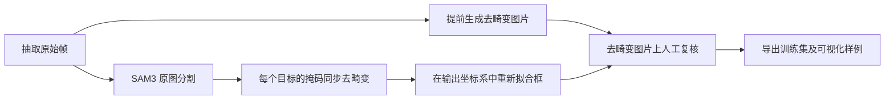

# SAM3 Auto OBB Annotator

基于 SAM3 / MobileSAM 的桌面自动标注工具，可导出 YOLO-OBB 旋转框或 YOLO-HBB
普通框。本项目由指定脚本 `final_auto_obb_qt2_dedup.py` 整理而成，保留了 SAM3
文本提示、模板/背景模式、特征校验和增强去重逻辑。

灰色手套与 Orbbec 四目 MP4 / MCAP 数据使用 `run_gray_gloves.py`：统一执行原图分割、
掩码同步去畸变、框重新拟合和人工复核。流程与操作见下文
[灰手套与四目录像](#gray-glove-workflow)。

## 主要功能

- **SAM3 文本提示模式**：输入 `hand`、`cup` 等英文目标名称，SAM3 直接检测并分割。
- **传统模板模式**：文本提示留空时，模板匹配/背景差分生成候选，MobileSAM 分割。
- 可选 YOLO-OBB 四点格式或 YOLO-HBB `cx cy w h` 格式。
- SAM3 结果自动分配 `left` / `right` 类别。
- mask/box IoU 去重、包含小框抑制、近邻双框抑制。
- CUDA OOM 时自动降低 MobileSAM batch。
- 可视化输出和缓存结果重新过滤。
- 灰手套模式支持四目 MP4 / MCAP 抽帧、原图 SAM3 分割及去畸变标签同步。
- 人工复核结果即时保存，支持重新载入项目、撤销和仅重检待复核图片。
- 灰手套及通用标注器导出的训练集附带最多 10 张可视化样例、总览图和样例来源说明。

<a id="gray-glove-workflow"></a>

## 灰手套与四目录像（run_gray_gloves.py）

### 启动与统一操作入口

安装环境并将 SAM3 权重放入 `models/sam3.pt` 后运行：

```bash
conda activate annotator  # 使用已有 conda 环境时；也可使用下文的 .venv
python run_gray_gloves.py
```

1. 添加 MP4 / MCAP 文件或录像文件夹，设置抽帧间隔和起止时间。MCAP 默认选择四路相机。
2. 点击唯一的 **“抽帧并载入”** 按钮，完成后按 **F5** 开始检测；也可以直接按 F5，
   程序会先抽帧，再自动开始检测。
3. 对 Orbbec 四目录像，程序自动匹配标定并进入同步流程，用户无需选择原图/去畸变模式。
   抽帧进度显示“去畸变抽帧”，复核及放大窗口显示去畸变图片。
4. 人工确认或修正框及左右手类别，最后导出训练集。

### 数据处理路线与图像坐标

检测主线是 **抽帧保留原图 → SAM3 原图分割 → 掩码同步去畸变 → 重新生成框**。
图片在抽帧阶段提前去畸变，供后续复核使用；SAM3 始终读取对应的原始帧。



图像和掩码使用同一套相机标定、保留视野及映射参数。图像只去畸变一次；检测阶段转换的是
分割掩码，不会再次对图片去畸变。掩码使用最近邻插值，转换后重新拟合框，不直接变换原框
四角，也不额外扩大框。预览、补框、人工修改和导出的标签均采用去畸变图片坐标。

原始帧以无损 PNG 缓存在抽帧目录的 `raw_frames/`，只用于检测，不进入训练集导出。
旧抽帧没有缓存时，程序根据 `extract_*.json` 记录的录像、相机和原始帧号恢复对应原图。
每轮检测时 SAM3 只对原图推理一次；新增的耗时主要来自掩码映射和缓存读写，
旧 MCAP 首次回读可能较慢。把图片去畸变延后与掩码一起处理也能得到相同坐标，
但不会省去图像变换这次计算；当前采用提前准备图片的方式，使复核图片始终处于最终坐标系。

### 标定、相机与默认设置

标定可自动从录像所在目录或上级录制目录查找，也可在界面手动指定：

- MP4 常见标定文件：`*_calibration_camera.yaml`。
- MCAP 常见标定文件：`*_params_cam_*.yaml`。
- 对应关系：`camera_left/right/right_side/left_side` 分别为 `cam_0/1/2/3`。
- 缺少标定、标定内容改变、序列号或分辨率不匹配时会明确报错，不会自动退回原图模式。

| 设置 | 新项目默认值 | 含义 |
| --- | --- | --- |
| 检测区域 | 整张图片 | 可在去畸变图片上改选矩形或圆形区域 |
| 最低检测置信度 | `0.20` | 保留可能的低分真实手候选 |
| 低分复核阈值 | `0.50` | 低于此值的已选框保留，并进入待人工复核 |
| 自动选框 | 去重后置信度最高的两个框 | 最多两只，允许只有一只，不生成缺失的手 |
| 导出格式 | YOLO-HBB | 也可选择 YOLO-OBB；类别为 `0: left`、`1: right` |
| 抽帧间隔 | 每 1 秒一张 | 切换按帧时默认每 30 帧一张 |
| 保留视野 | `0` | 调高可保留更多边缘视野，可能增加黑边 |

例如两个不同位置的框分数为 `0.82` 和 `0.35`，默认都保留，由用户复核第二个框。
“低分复核阈值”不会删除候选框。勾选“显示未选候选框”可查看和补选其他检测结果。

主视角双手默认按画面左右分配 `left/right`，镜像画面可切换对应规则。侧视相机使用左右手
提示词辅助核对，`cam_2` 的先验为 `right`、`cam_3` 为 `left`；证据不足或冲突时待人工确认。
实际定位提示词为：

```text
hand wearing a light gray glove
hand wearing a gray protective work glove
hand wearing a protective work glove
```

启用侧视自动分类时追加 `left gloved hand` 和 `right gloved hand`，用于左右手判断。

### 项目保留、复核与旧数据

四目去畸变项目保存在旁边的 `*_undistorted` 目录，包含 `project.json`、`review.jsonl`
和 `video_frames/collection/`。人工修改即时写入 `review.jsonl`；重新打开程序可恢复最近
项目和上次查看的图片，也可点“打开已有复核项目”手动选择结果目录，继续复核或直接导出。

- **旧四目原图项目**：按 F5 后，先按当前抽帧设置建立独立的去畸变项目，再检测。
  原项目图片和标签保留；原图坐标的人工框不会直接复制到新坐标系。
- **已有去畸变项目**：应用新检测流程时先备份配置和记录，保留同一图片目录中已人工确认
  的结果；原图缓存缺失时需原录像可用，掩码同步还需原标定文件。
- **仅重检待人工复核**：只重新推理待复核图片，其他记录保持；单张重检失败时保留原记录。
- **普通图片目录**：直接在所选图片上检测；外部去畸变图片若没有抽帧来源记录，不能自动
  反查原图。普通视频与四目录像分批导入。

| 操作 | 快捷键 |
| --- | --- |
| 开始/继续检测 | `F5` |
| 确认目标并跳到下一张待复核 | `Space` |
| 确认无目标并跳到下一张待复核 | `Q` |
| 明确指定 left / right | `Alt+1` / `Alt+2` |
| 交换左右类别 | `Alt+X` |
| 撤销人工操作 | `Ctrl+Z` |
| 上一张 / 下一张图片 | `B` / `N` |
| 打开已有复核项目 | `Alt+P` |
| 放大查看 / 展开收起设置 | `Alt+Z` / `Alt+S` |
| 导出训练集 | `Ctrl+E` |

确认目标或无目标后，只有保存成功才跳转。撤销历史属于当前会话，关闭程序、切换项目或
开始重检后清空。更多抽样、来源恢复和复核规则见 [GRAY_GLOVE_MODE.md](GRAY_GLOVE_MODE.md)。

## 旧版 run.py 的类别与左右手标注规则

本节适用于 `run.py`，灰手套入口使用上文的复核和侧视相机规则。
旧版程序的“左右手”是**按图像位置**分配，不是根据手掌外观判断真实左右手：

- 文本提示中包含 `hand` 或 `hands` 时，自动启用两类：`0=left`、`1=right`。
- 只有一个手时，框中心位于图像左半边标为 `left`，右半边标为 `right`。
- 检测到两只手时，横坐标更小的框标为 `left`，更大的框标为 `right`。
- 超过两个候选框时，以最左和最右候选框中心的中点作为分界。

因此，如果相机画面发生镜像、目标左右定义不是“画面左右”，需要在导出后人工检查，
或修改 `assign_left_right_classes()` 的规则。

其他物体不会再自动套用 `left/right`：

- 文本提示填写 `cup`、`bottle`、`box` 等时，默认生成单类别标签 `0`。
- 界面中的“类别名称”可以填写 `cup`、`bottle` 等，程序会把它写入 `dataset.yaml`。
- 如果类别名称保持 `object`，程序会尝试从第一个文本提示推断，例如 `cup` → `cup`。
- 一次运行建议只使用一个物体类别；如果要做 `cup`、`bottle` 多类别数据集，分别运行并
  合并数据集，或后续扩展为多文本提示到类别 ID 的映射。SAM3 返回的是目标框/掩码，
  当前代码不会自动知道同一张图中每个候选框对应哪个不同类别。

推荐示例：

| 目标 | 文本提示 | 类别名称 | 输出类别 |
|---|---|---|---|
| 双手 | `hand` | 任意（忽略） | `left`, `right` |
| 杯子 | `cup` | `cup` | `cup` |
| 瓶子 | `bottle` | `bottle` | `bottle` |
| 化妆盒 | `cosmetic box` | `cosmetic_box` | `cosmetic_box` |
- 所有数据、权重路径均使用项目相对路径或环境变量，不绑定某台电脑。

## 项目结构

```text
auto-obb-annotator/
├── auto_obb_annotator/
│   ├── app.py               # 来自 final_auto_obb_qt2_dedup.py 的主程序
│   ├── app_gray_gloves.py   # 灰手套抽帧、原图检测与人工复核入口
│   ├── gray_glove_video.py  # MP4 / MCAP 抽帧及原图缓存
│   ├── gray_glove_mcap.py   # MCAP 相机流解码
│   ├── orbbec_undistort.py  # KB 鱼眼标定与共享去畸变映射
│   ├── gray_glove_projection.py # 原图掩码投影及输出框重新拟合
│   ├── dataset_preview.py   # 导出训练集可视化抽查样例
│   ├── project_paths.py     # 统一管理项目路径和模型路径
│   ├── __main__.py
│   └── __init__.py
├── data/                    # 原图与导出结果，默认不进 Git
├── models/
│   ├── sam3.pt              # 约 3.45 GB，本机存在，但被 Git 忽略
│   └── mobile_sam.pt        # 传统模板模式的回退模型
├── scripts/check_setup.py
├── pyproject.toml
├── requirements.txt
├── run_gray_gloves.py
└── run.py
```

## 模型文件与 GitHub 限制

SAM3 权重大小约 **3.45 GB**，而 GitHub 普通 Git 的单文件硬限制是 **100 MB**，所以
`models/sam3.pt` 已加入 `.gitignore`。当前新项目文件夹中已经复制了该文件，可以本机
直接运行，但 `git add .` 不会上传它。

### 下载 SAM3 权重

SAM3 需要手动下载核心模型权重，否则文本提示模式无法正常运行：

- 模型文件：`sam3.pt`
- ModelScope 下载地址：[facebook/sam3/sam3.pt](https://modelscope.cn/models/facebook/sam3/resolve/master/sam3.pt)

可以直接下载到项目的 `models/` 目录：

```bash
wget -O models/sam3.pt \
  https://modelscope.cn/models/facebook/sam3/resolve/master/sam3.pt
```

也可以使用浏览器打开上述链接下载，然后将文件放到：

```text
models/sam3.pt
```

如果权重放在其他目录，可以通过绝对路径指定：

```bash
export SAM3_MODEL_PATH=/absolute/path/to/sam3.pt
```

当前本地权重校验值：

```text
SHA256 9999e2341ceef5e136daa386eecb55cb414446a00ac2b55eb2dfd2f7c3cf8c9e
```

如确实需要通过 GitHub 分发 3.45 GB 权重，普通 Git 和免费的 Git LFS 通常都不合适，
建议使用模型官方发布地址、Hugging Face、对象存储或单独的 Release/下载说明，并确认
模型许可证允许重新分发。

## 环境安装

建议 Linux、Python 3.10/3.11、NVIDIA GPU 和 CUDA。

先根据显卡/CUDA 版本从 [PyTorch 官方说明](https://pytorch.org/get-started/locally/)
安装合适的 PyTorch，再安装项目：

```bash
git clone https://github.com/zdh1213112/autoannotate_datasets_sam3.git auto-obb-annotator
cd auto-obb-annotator

python3 -m venv .venv
source .venv/bin/activate
python -m pip install --upgrade pip
# 按 PyTorch 官网命令安装 CUDA 版 torch
pip install -r requirements.txt
pip install -e .
```

SAM3 文本 API 要求包含 `SAM3SemanticPredictor` 和 `build_sam3_image_model` 的新版
Ultralytics。本项目依赖声明为 `ultralytics>=8.4.38`。
灰手套四目模式还需要 PyYAML；MCAP 解码需要 `mcap`、`mcap-protobuf-support` 和 `av`，
均已列入 `requirements.txt`。

安装完成后检查：

```bash
python scripts/check_setup.py
```

如果希望同时验证大模型 SHA-256（需要读取整个 3.45 GB 文件，会比较慢）：

```bash
CHECK_MODEL_HASH=1 python scripts/check_setup.py
```

## 运行

灰手套与四目录像使用 `python run_gray_gloves.py`，按上文统一入口操作。
旧版文本提示/模板模式仍使用：

```bash
python run.py
```

D435 条形码单目标数据集使用独立入口，包含限定区域、逐张实时预览和人工修正：

```bash
python run_barcode.py
```

使用步骤见 [`BARCODE_MODE.md`](BARCODE_MODE.md)。

自行设置类别、提示词和每张目标数量的通用入口：

```bash
python run_generic.py
```

使用步骤见 [`GENERIC_MODE.md`](GENERIC_MODE.md)。

灰白护具 + 黑色手指的第一视角防护手套数据，使用完整框专用入口：

```bash
python run_protective_gloves.py
```

该入口默认导出 HBB，连接分开的手指/掌面 mask、增加完整框留边，并在主窗口
逐张实时显示标注结果。详细说明见
[`PROTECTIVE_GLOVE_MODE.md`](PROTECTIVE_GLOVE_MODE.md)。
原来的纯黑手套模式仍使用 `python run_black_gloves.py`，详细说明见
[`BLACK_GLOVE_MODE.md`](BLACK_GLOVE_MODE.md)。

OpenTouch 已解码图片只标注完整可见右手、并逐帧交付 `bboxes.jsonl` 时，使用独立入口：

```bash
python run_opentouch_bboxes.py
```

该入口不生成 YOLO 标签。详细规则和输出格式见
[`OPENTOUCH_BBOX_MODE.md`](OPENTOUCH_BBOX_MODE.md)。

安装为可编辑包后也可以：

```bash
auto-obb-annotator
# 或 python -m auto_obb_annotator
```

### SAM3 文本提示模式（推荐）

1. 选择原始图片目录和独立导出目录。
2. “文本提示”填写英文目标，例如 `hand`。
3. 如果不是 hand，在“类别名称”填写训练类别，例如 `cup`。
4. 选择 OBB 或 HBB 标签格式。
5. 固定机位时勾选“只标注灰色台面区域”。默认区域对应示例中的红框；如机位不同，
   点击“重新框选台面区域”，拖框后按 `Space` 确认。
6. 点击“一键开始自动标注”。

只要文本提示非空，程序就要求 `sam3.pt` 存在并使用 SAM3；找不到时会明确报错，不会
静默切换成别的检测模型。

工作区域过滤会同时用于 SAM3、GroundingDINO 和模板模式：候选框中心必须位于区域内，
并且至少 50% 的框面积与区域相交。区域坐标按图片宽高归一化并自动保存，因而同一固定
机位即使图片分辨率改变也可继续使用。

### 模板 + MobileSAM 模式

1. 文本提示保持为空。
2. 可选背景目录。
3. 点击“提取/旋转模板”，框选几个代表性目标。
4. 点击“一键开始自动标注”。

此模式使用 `models/mobile_sam.pt`，适合不希望用文本提示或需要沿用原有流程的场景。

## 输出目录

```text
output/
├── images/train/
├── images/val/
├── labels/train/
├── labels/val/
├── visualizations/
└── dataset.yaml
```

灰手套及通用标注器的 `visualizations/` 包含：

```text
visualizations/
├── train__*.jpg   # 带实际训练标签框和类别的样例
├── val__*.jpg     # 验证集样例
├── overview.jpg   # 全部样例的总览图
└── README.md      # 类别及原图、标签对应路径
```

默认从本次实际导出的图片中选取最多 **10 张**，不足 10 张时全部展示。优先覆盖训练/验证集、
类别、相机视角和无目标样本，其余名额分散选取。预览直接读取最终 YOLO 标签：HBB 画普通框，
OBB 画旋转框，训练原图保持原样。待复核、待重检和未抽中的图片不进入这批训练集及预览。

OBB 标签：

```text
class_id x1 y1 x2 y2 x3 y3 x4 y4
```

HBB 标签：

```text
class_id center_x center_y width height
```

坐标均归一化到 `[0, 1]`。`dataset.yaml` 使用 `path: .`，整个导出目录移动后仍可使用。

## 可选 GroundingDINO 资源

代码保留了原脚本中的 GroundingDINO ONNX 类，资源路径可以用以下环境变量配置：

```bash
export GROUNDING_DINO_MODEL=/absolute/path/to/groundingdino_swint_ogc_quant.onnx
export GROUNDING_DINO_TOKENIZER=/absolute/path/to/bert_base_uncased_tokenizer.json
```

当前文本提示主流程优先且强制使用 SAM3；通常不需要配置这两个资源。


## 第三方与许可证

参见 [THIRD_PARTY.md](THIRD_PARTY.md)。权重不等同于原创程序代码许可证，请确认 SAM3、
Ultralytics、MobileSAM 及权重文件的上游许可证后再分发或商用。

本仓库暂未添加原创代码的 `LICENSE`，发布前请根据代码权属选择合适许可证。
